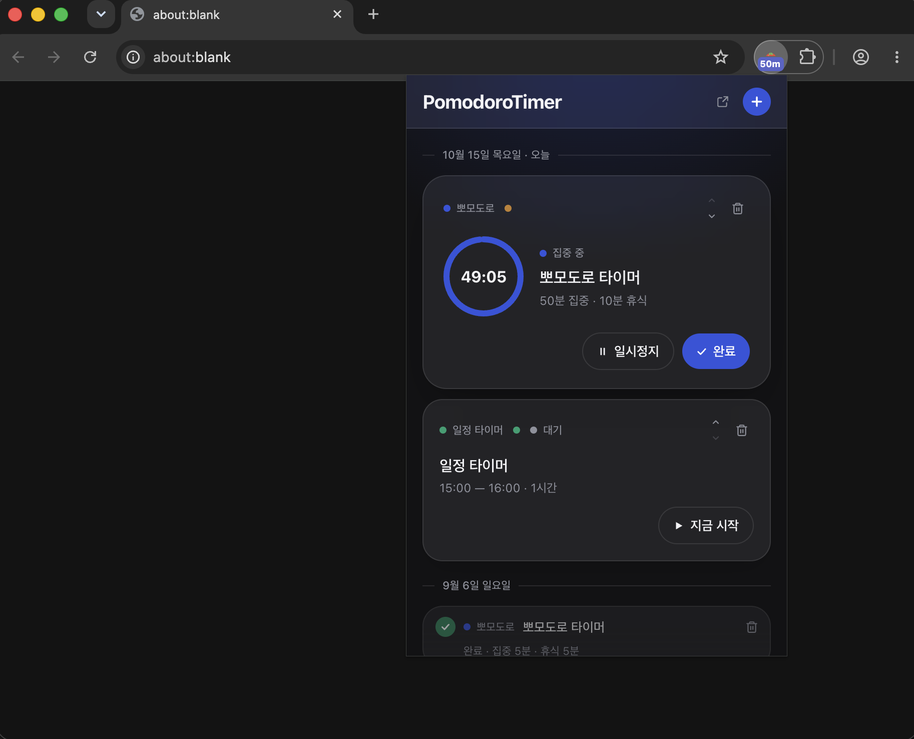
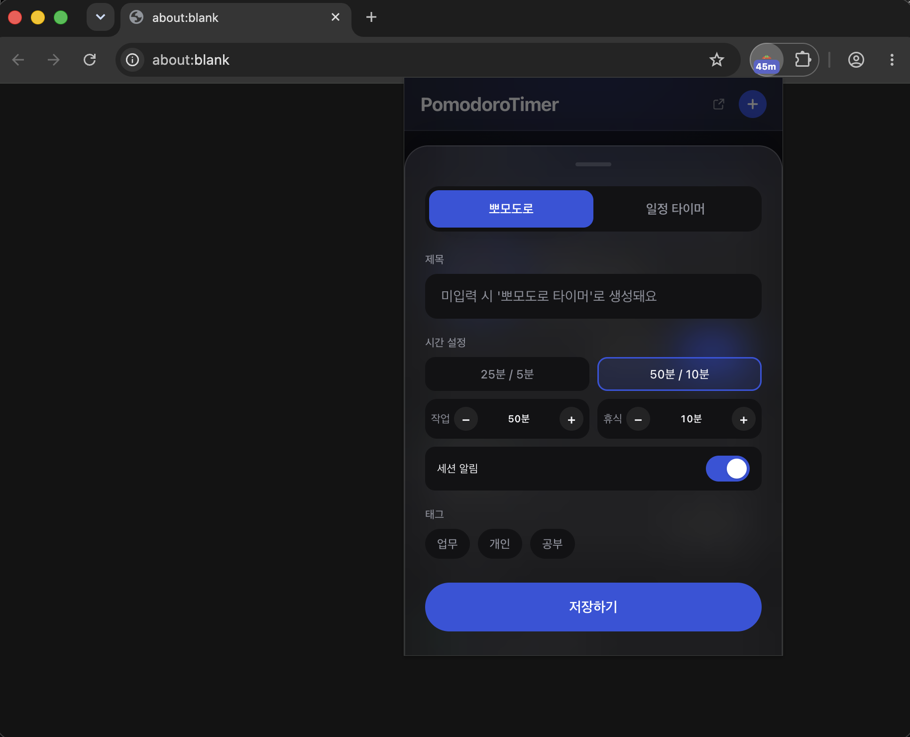
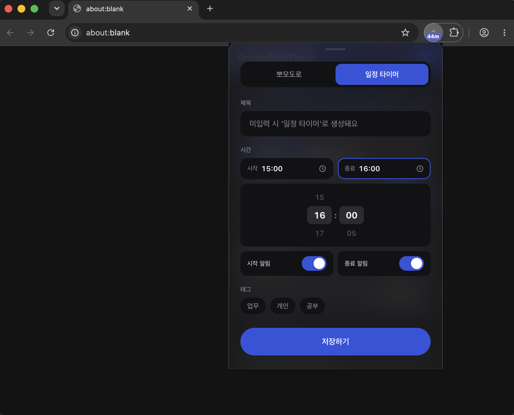

# PomodoroTimer

뽀모도로 타이머와 일정 타이머를 **하나의 스티키노트 리스트**로 관리하는 Chrome 확장 프로그램입니다.

<p align="center">
  
</p>

## 주요 기능

- **두 가지 노트 타입** — 작업/휴식 시간을 직접 정하는 `뽀모도로`, 시작·종료 시각이 정해진 `일정`
- **팝업을 닫아도 계속 흐르는 타이머** — 종료 감지·알림을 백그라운드 서비스 워커가 담당
- **세션 종료 시 완료 / 연장 / 넘기기 선택** — 연장하면 오늘 남은 일정들의 시각이 자동으로 밀림
- **타이머 전환 시 상태 보존** — 다른 노트를 시작해도 기존 노트의 단계·남은 시간을 기억해 이어서 진행
- **알림** — OS 알림, 알림음, 확장 아이콘 뱃지(남은 분)
- **태그·순서 정리**, 라이트/다크 모드, 기기 간 동기화

### 노트 만들기

| 뽀모도로 | 일정 타이머 |
| :---: | :---: |
|  |  |
| 프리셋 또는 직접 작업·휴식 시간 설정 | 시작·종료 시각을 휠로 선택 |

## 기술 스택

| 영역 | 사용 기술 |
| --- | --- |
| UI | React 18, TypeScript, Tailwind CSS v4 |
| 상태 관리 | Zustand (persist → `chrome.storage.sync`) |
| 확장 프레임워크 | WXT (Manifest V3) |
| 브라우저 API | `alarms`, `notifications`, `offscreen`, `storage`, `action` |

## 구조

```
entrypoints/
  popup/        # 팝업 UI 진입점
  background.ts # 서비스 워커 — 타이머 종료 알람, 뱃지 갱신
  offscreen/    # 알림음 재생 전용 문서
src/
  components/   # 노트 카드, 생성 시트, 세션 종료 팝업
  store/        # Zustand 스토어 + chrome.storage 어댑터
  background/   # 뱃지·종료 알림 로직
  hooks/ utils/ types/
```

## 기술적 고민

**1. 팝업이 닫혀도 정확한 타이머**
Chrome 확장 팝업은 포커스를 잃으면 즉시 종료됩니다. 그래서 타이머는 `setInterval` 대신 **종료 시각(`endsAt`)을 저장**하고 남은 시간을 매번 계산하도록 했습니다. 종료 알림은 서비스 워커가 `chrome.alarms`로 예약해 팝업 상태와 무관하게 발송됩니다.

**2. 서비스 워커에서의 소리 재생**
MV3 서비스 워커는 Web Audio API를 쓸 수 없습니다. **Offscreen Document**를 하나만 유지하며 메시지로 재생을 요청하고, 동시 생성 요청은 하나의 Promise로 직렬화했습니다.

**3. 중복 알림 방지**
알람은 데이터를 담을 수 없고, 발화 시점엔 팝업이 이미 상태를 바꿨을 수 있습니다. 예약 시점의 정보(노트·단계·종료 시각)를 `chrome.storage.session`에 따로 보관해 **한 번의 종료에 한 번만** 알리도록 했습니다.

**4. 여러 창 간 상태 동기화**
팝업과 독립 창이 동시에 열려 있어도 `chrome.storage.onChanged`로 같은 상태를 실시간 반영합니다.

## 실행 방법

```bash
npm install
npm run dev     # 개발 모드 (Chrome 자동 실행)
npm run build   # .output/chrome-mv3 에 빌드
```

빌드 후 `chrome://extensions` → 개발자 모드 → **압축해제된 확장 프로그램 로드**에서 `.output/chrome-mv3` 폴더를 선택합니다.

단축키: `Alt+F` 팝업 열기
